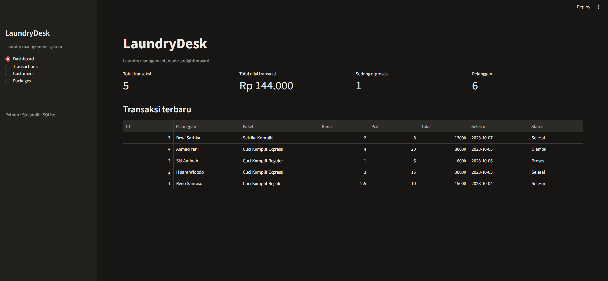

# LaundryDesk

**A desktop application for managing laundry operations.**

`Python` · `PyQt6` · `SQLite`

LaundryDesk is a desktop-based laundry management system developed as a final project for the Desktop Programming course. It provides a practical way to manage customer records, laundry packages, and transaction data through a graphical interface backed by a relational database.

## Interface Preview

<p align="center">
  
</p>

## Features

- **Transaction Management** Create, view, update, and delete laundry transactions.
- **Customer Management** Maintain customer information and records.
- **Laundry Packages** Manage available services, pricing, and estimated completion times.
- **Transaction Filtering** Find records by customer name and transaction status.
- **Automatic Price Calculation** Calculate transaction costs based on laundry weight, package price, and discount.
- **Completion Estimation** Determine expected completion dates using package duration.
- **Relational Data Management** Maintain relationships between customers, packages, and transactions.

## Database Design

LaundryDesk uses SQLite with three main entities:

| Table | Description |
|---|---|
| `customers` | Stores customer information |
| `packages` | Stores laundry services and pricing |
| `transactions` | Stores laundry orders and their status |

Transactions reference customers and packages through foreign keys, providing a structured relational data model.

## Tech Stack

| Technology | Purpose |
|---|---|
| Python | Application logic |
| PyQt6 | Desktop user interface |
| SQLite | Relational database |

## Getting Started

### Requirements

- Python 3.x
- pip

### Installation

Clone the repository:

```bash
git clone https://github.com/haninhammoud01/LaundryDesk.git
cd LaundryDesk
```

Install the dependency:

```bash
python -m pip install PyQt6
```

### Run the application

```bash
python laundry_uas.py
```

The application uses `laundry_uas_final.db` as its SQLite database. Keep the database file in the project directory when running the application.

## Project Structure

```text
LaundryDesk/
├── assets/
│   └── image.png
├── laundry_uas.py
├── laundry_uas_final.db
└── README.md
```

## Project Context

| | |
|---|---|
| Course | Desktop Programming |
| Project Type | Final Examination Project |
| Application | Desktop Laundry Management System |
| Developer | [haninhammoud01](https://github.com/haninhammoud01) |

## Learning Outcomes

This project provided hands-on experience in desktop application development, CRUD operations, relational database design, SQL integration, and organizing application workflows.

---

*Built as an academic project, with an emphasis on practical functionality and structured data management.*
